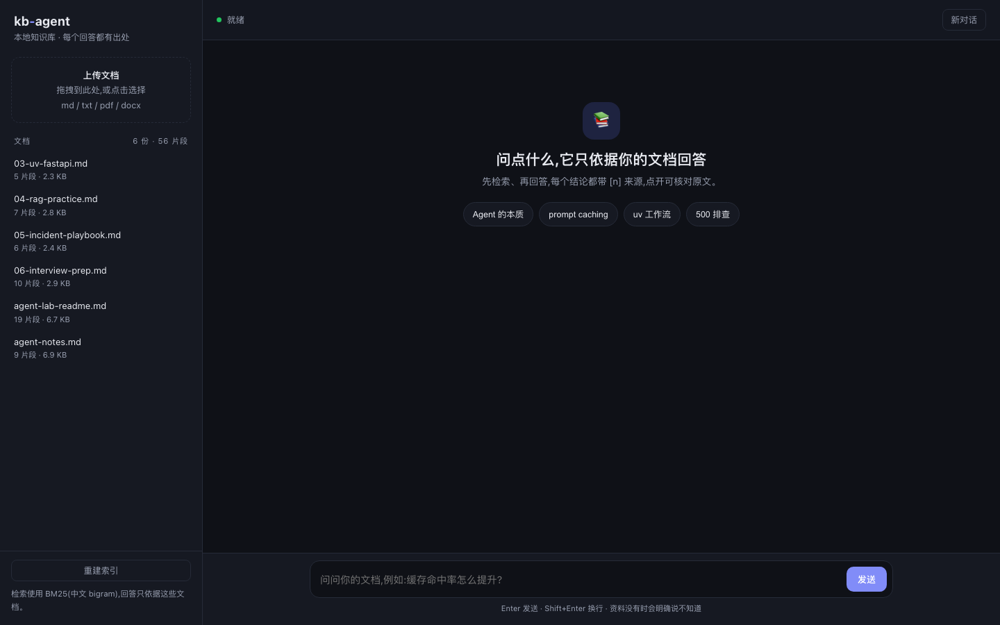

# kb-agent

[](https://github.com/westsonGoogle/kb-agent/actions/workflows/ci.yml)
[](https://github.com/westsonGoogle/kb-agent/actions/workflows/secret-scan.yml)

> 把文档丢进去，提问，得到一个**带出处**的回答。不是另一个聊天玩具。

<p align="center">
  
</p>

一个可运行的本地知识库 Agent：

- **Agentic RAG**：模型自己决定搜什么、搜几次，而不是把整篇文档硬塞进 prompt
- **中文友好的 BM25 检索**：字/词混合分词，零 embedding、零向量库、离线可跑
- **引用可追溯**：每个结论带 `[n]`，点开就是文件名 + 行号/页码 + 原文片段
- **CLI + Web 双入口**：Web 支持拖拽上传、流式输出、引用展开
- **SQLite 持久化**：重启不丢索引
- **离线测试**：不联网也能跑完整个测试集

底层 Agent 循环来自同作者的另一个仓库
[agent-lab](https://github.com/westsonGoogle/agent-lab)（手写、无框架），
本项目只负责「知识库」这一层：解析、切块、检索、引用。

---

## 快速开始

```bash
uv sync

cp .env.example .env
# 编辑 .env，填入任意 OpenAI 兼容端点的 LLM_BASE_URL / LLM_API_KEY / LLM_MODEL

# 导入文档（示例文档已放在 data/docs）
uv run kb reindex

# 方式一：Web
uv run kb serve --port 8000
# 打开 http://127.0.0.1:8000

# 方式二：CLI
uv run kb chat
uv run kb ask "prompt caching 怎么才能命中?"
```

其他命令：

```bash
uv run kb docs                    # 看已索引文档和块数
uv run kb ingest ~/notes/xxx.md   # 导入单个文件
uv run kb ingest ~/notes/         # 导入整个目录（递归）
uv run kb reindex                 # 重建索引（改过文件后用）
uv run pytest                     # 离线测试
```

支持格式：`.md` / `.txt` / `.pdf` / `.docx`，单文件上限 20MB。
扫描版 PDF 需要先 OCR，否则提取不到文字。

---

## 它一次回答发生了什么

```
用户提问
   │
   ▼
Agent 循环（agent-lab）
   │  1. 模型决定调用 search_kb("prompt caching 命中")
   ▼
BM25 检索 ──▶ 命中片段 + 编号 cite=1,2,3...
   │  2. 片段回填给模型（role=tool）
   ▼
模型基于片段写答案，并标注 [1][2]
   │  3. 服务端把 cite 和真实文件/行号绑定
   ▼
Web/CLI 只展示「答案里真正引用到的」来源
```

关键点：**检索是模型主动发起的工具调用**，不是请求前偷偷拼一段上下文。
模型可以换关键词重搜，也可以打开整篇文档核对。

### 引用为什么可信

1. 检索工具返回的每条结果都带 `cite` 编号，编号由服务端登记，模型不能自造。
2. system prompt 强制要求每个结论标注 `[n]`。
3. 前端只渲染答案中实际出现的编号，点开显示绑定的真实片段。
4. 编号对应的内容对不上，用户一眼就能发现——**幻觉变得可审计**。

---

## 检索设计（以及为什么先不上向量库）

### 切块

- Markdown **按标题切段**，再按 800 字上限切块，重叠 120 字。
- 这样每个块的起点是标题，引用展示不会从上一节的半句话开始。
- 记录 `start_line`（PDF 记录 `page`），引用才能落到具体位置。

### 检索

- 中文没有空格，用**连续汉字 bigram**（`知识库` → `知识` / `识库`）做词项。
- 英文按单词切分，统一小写。
- BM25（k1=1.5，b=0.75），标题命中加权 1.15。
- 查询侧过滤疑问词/功能词（怎么、哪些、如何……）。
- 低于最高分 30% 的结果直接丢弃；同一份文档最多保留 2 段。

这套方案在几百到几万块的个人知识库上足够快，也足够可解释。
它**不擅长同义词**（搜“报销”未必命中“费用申请”），这是下一步加向量召回的动机，
而不是一上来就堆 Pinecone + LangChain 的理由。

### 关键参数

| 环境变量 | 默认 | 说明 |
| --- | --- | --- |
| `KB_DATA_DIR` | `data` | 数据目录 |
| `KB_DOCS_DIR` | `data/docs` | 文档目录 |
| `KB_DB_PATH` | `data/kb.db` | SQLite 路径 |
| `KB_TOP_K` | `6` | 每次检索返回条数 |
| `KB_CHUNK_CHARS` | `800` | 切块上限（字符） |
| `KB_CHUNK_OVERLAP` | `120` | 块间重叠 |
| `KB_OPEN_DOC_LINES` | `200` | `open_document` 默认读取行数 |

---

## HTTP API

| 方法 | 路径 | 说明 |
| --- | --- | --- |
| `GET` | `/` | Web 界面 |
| `GET` | `/api/health` | 健康检查 |
| `GET` | `/api/documents` | 文档列表 + 块数 |
| `POST` | `/api/upload` | 上传并索引（multipart `file`） |
| `DELETE` | `/api/documents/{id}` | 删除文档（连同文件） |
| `POST` | `/api/reindex` | 重建索引 |
| `POST` | `/api/chat` | SSE 聊天，body：`{"message": "...", "session_id": "..."}` |
| `DELETE` | `/api/sessions/{id}` | 丢弃会话 |

SSE 事件类型：`session` / `text` / `tool_call` / `tool_result` / `usage` /
`sources` / `done` / `error` / `end`。

```bash
curl -N -X POST localhost:8000/api/chat \
  -H 'Content-Type: application/json' \
  -d '{"message":"线上 500 怎么排查?","session_id":"demo"}'
```

---

## 目录

```
src/kbagent/
├── config.py      # 模型配置(复用 agentlab)+ 知识库参数
├── loaders.py     # md/txt/pdf/docx -> 文本段落
├── chunking.py    # 标题感知切块,保留行号
├── store.py       # SQLite: documents / chunks
├── retrieval.py   # 分词 + BM25 + 阈值/去重
├── citations.py   # 引用登记簿 + 查询相关片段
├── kb.py          # 存储/索引/检索门面
├── agent.py       # system prompt + 三个工具
├── cli.py         # kb chat / ask / ingest / docs / reindex / serve
├── server.py      # FastAPI + SSE
└── web/index.html # 单文件 Web UI(无构建、无 CDN)
tests/             # 离线测试(不联网、不需要 Key)
data/docs/         # 示例文档
```

---

## 测试

```bash
uv run ruff check .
uv run pytest
```

测试全部注入 `FakeLLM` 或临时 SQLite，不需要 API Key，也不会访问网络。
覆盖：切块行号、中文检索、阈值与去重、引用编号、存储增删改、上传/删除、SSE 事件。

---

## 已知限制

- BM25 不处理同义词；跨语言（中文问、英文文档）只能靠共享的英文术语。
- 单用户、无鉴权，别直接暴露到公网。
- 上传同名文件会覆盖旧文件；需要版本管理就自己加时间戳。
- 扫描版 PDF 不支持，需先 OCR。
- 没有文件监听；文档变更后手动 `kb reindex`。
- Agent 最多 6 步，复杂问题可能提前收手。

## Roadmap

- 混合检索：BM25 + embedding + RRF 融合
- 小型评测集：30 条问题，量化召回率 / 忠实度 / 拒答率
- 多租户与文档级权限（检索前过滤）
- 引用高亮到具体句子，而不只是行号
- Docker Compose 一键部署

---

## License

[MIT](LICENSE) © 2026 westson
